<h3><code>debjit@github ~ $ contributions</code></h3>

  

<h3><code>debjit@github ~ $ whoami</code></h3>
<table>
  <tr>
    <td valign="top"></td>
    <td valign="top"></td>
  </tr>
</table>

  

<h3><code>debjit@github ~ $ ls projects/</code></h3>

| Project | What it does |
|---|---|
| [**Prototype-Agent**](https://github.com/DebjitXD/Prototype-Agent) | Creates the diagram, BOM, circuit connections and firmware for an embedded prototype from your requirement, using your own API key |
| [**math-air-canvas**](https://github.com/DebjitXD/math-air-canvas) | Draw digits and math symbols in the air and get the answer on screen |

<!-- To add a project, copy a row above and change the name, link and description. -->
