<h3><code>debjit@github ~ $ whoami</code></h3>

<h3><code>debjit@github ~ $ ls projects/</code></h3>

| Project | What it does | Built with |
|---|---|---|
| [**Prototype-Agent**](https://github.com/DebjitXD/Prototype-Agent) | Turns a plain-English requirement into a block diagram, parts list, pin mapping, firmware and test plan. Four AI agents do the work and you approve every stage. | Python, Flask, ESP32, Pico, Arduino |
| [**math-air-canvas**](https://github.com/DebjitXD/math-air-canvas) | Draw digits and math symbols in the air with your finger and see the answer on screen. | Python, OpenCV, MediaPipe, scikit-learn |

<!-- To add a project, copy a row above and change the name, link, description and tools. -->

<h3><code>debjit@github ~ $ contact</code></h3>

[Email](mailto:debjitbiswasjojo@gmail.com)

<!-- To add LinkedIn, change the line above to: [Email](mailto:debjitbiswasjojo@gmail.com) | [LinkedIn](https://www.linkedin.com/in/your-id) -->

